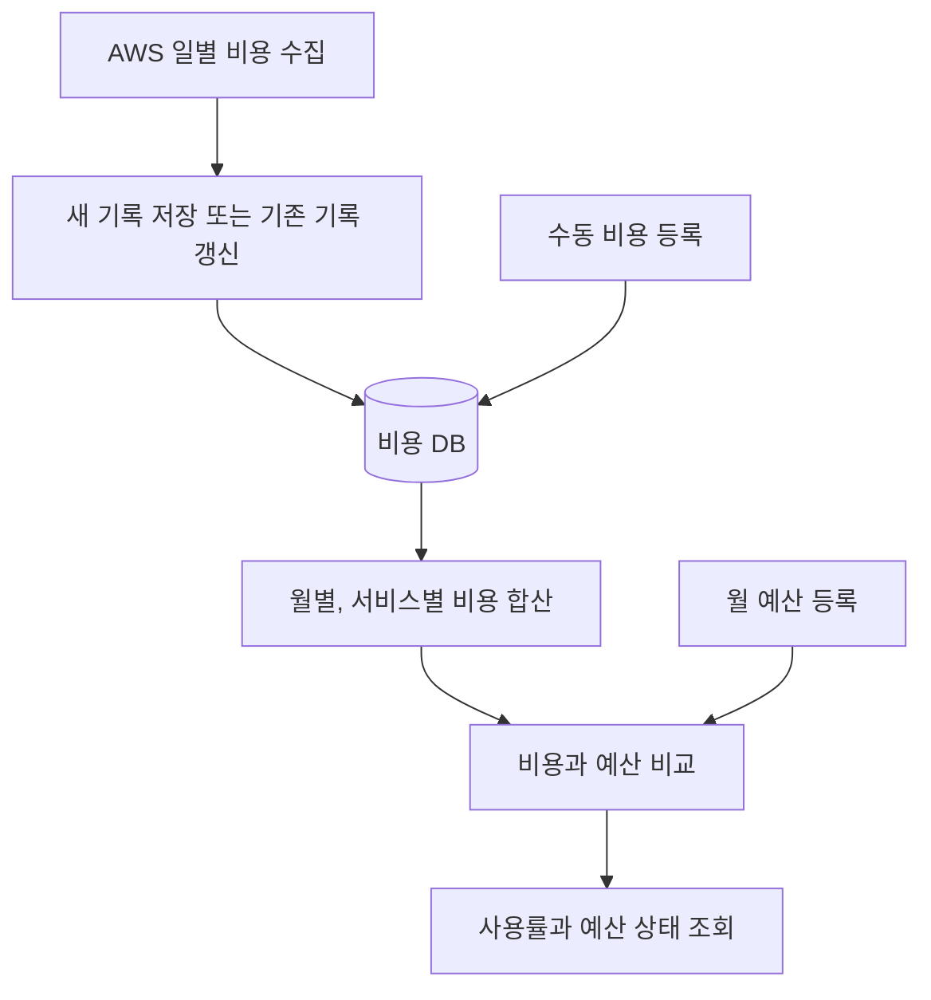

# CloudGuard | AWS 비용과 월 예산 관리

AWS 실습 비용을 월 예산과 함께 확인하려고 만든 개인 백엔드 프로젝트입니다. 일별 비용을 저장하고 월별, 서비스별 합계와 예산 사용 상태를 제공합니다.

**Java 17, Spring Boot 4.1, Spring Data JPA, MySQL, AWS SDK, Docker, AWS**

## 전체 흐름



AWS 비용과 수동 비용은 출처를 구분해 저장하고, 월 합계에는 두 비용을 모두 반영합니다. 재수집은 AWS 기록만 갱신합니다.

## 문제 해결

### 1. 같은 기간을 다시 수집하면 비용이 중복되는 문제

- **문제:** 이미 가져온 비용을 계속 추가하면 월 합계가 부풀려집니다. 직접 입력한 비용과 AWS에서 가져온 비용도 구분해야 했습니다.
- **해결:** 날짜, 서비스, 출처를 기준으로 기존 AWS 기록을 찾습니다. 없으면 추가하고, 있으면 금액을 갱신하며 수동 입력 비용은 보존합니다.
- **확인 결과:** 테스트에서 AWS 금액을 10.5에서 12로 바꿔도 기록은 한 건으로 유지되고, 수동 비용 100은 그대로 남았습니다. 실제 AWS에서도 같은 기간을 두 번 순서대로 수집한 뒤 **72건과 비용 합계가 유지되는 것을 SQL로 확인했습니다.**

### 2. 반올림 때문에 예산 상태가 잘못 바뀌는 문제

- **문제:** 예산 100에 비용 69.999이면 표시용 사용률은 반올림되어 70%가 될 수 있지만, 실제 비용은 아직 주의 기준인 70% 미만입니다.
- **해결:** 화면에 표시할 사용률과 상태 판정을 분리하고, 상태는 원래 비용과 예산을 비교해 결정했습니다.
- **확인 결과:** 70%, 85%, 100% 경계의 직전, 경계값, 직후를 테스트했습니다. 같은 월의 예산을 다시 등록하면 `409` 오류로 차단합니다.

## 실행하며 확인한 결과

- **실제 비용:** 2026년 11월 1일부터 18일까지의 비용 약 16.79 USD를 수집했습니다. 예산 20 USD에 사용률 **83.96%, CAUTION**이 반환됐습니다.
- **AWS 배포와 데이터 유지:** Docker 이미지를 ECR에 올려 EC2에서 실행하고 비공개 RDS MySQL에 저장했습니다. 앱을 다시 실행해도 비용과 예산이 유지됐습니다.
- **테스트:** GitHub Actions의 빌드와 테스트가 통과했습니다. AWS 배포는 수동으로 진행했으며 전체 자동 배포를 완료한 것은 아닙니다.

재수집은 한 번의 수집이 끝난 뒤 다음 수집을 실행하는 조건에서 검증했습니다. 동시 수집과 환불, 크레딧을 포함한 전체 청구서 처리는 아직 지원하지 않습니다. 상시 공개 서비스는 운영하지 않습니다.

## 로컬에서 확인하기

Docker 실행 후 저장소 루트에 `.env`를 만들고 아래 세 값을 로컬용으로 설정합니다. `.env`는 Git에 올리지 않습니다.

```dotenv
CLOUDGUARD_DOCKER_DB_USERNAME=cloudguard
CLOUDGUARD_DOCKER_DB_PASSWORD=your_local_password
CLOUDGUARD_DOCKER_DB_ROOT_PASSWORD=your_other_local_password
```

```bash
docker compose up --build -d
```

앱은 `http://localhost:8080`에서 실행됩니다. 기본 월별 조회는 `/api/costs/monthly/breakdown?yearMonth=2026-11`이며, 빈 DB에서는 합계가 0입니다. 실제 AWS 수집에는 별도 AWS 인증과 Cost Explorer 조회 권한이 필요합니다.

