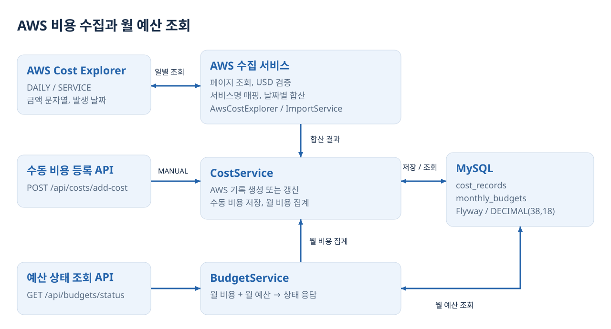
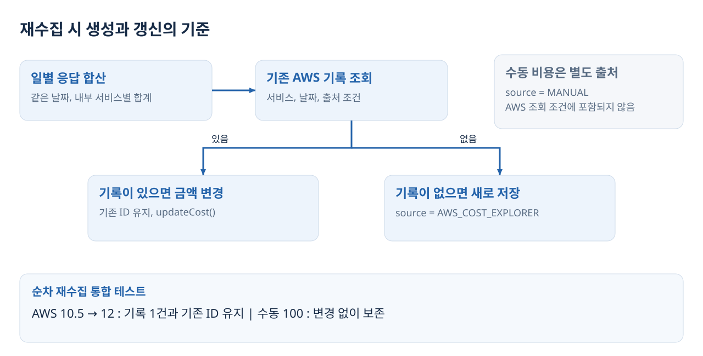
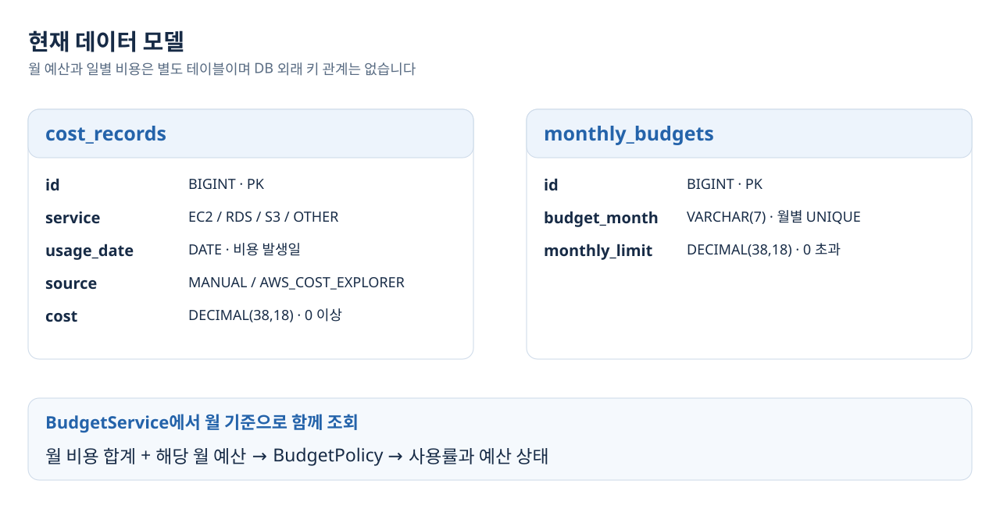

# CloudGuard

**AWS 비용을 일별로 수집하고 월별, 서비스별 집계와 예산 상태를 제공하는 Java/Spring 백엔드입니다.**

클라우드 실습 비용을 월 예산과 함께 확인하려고 만들었습니다. 같은 기간을 다시 수집하면 기존 AWS 기록을 갱신하고, 수동으로 등록한 비용은 보존합니다.

[최신 AWS 검증 기록](docs/AWS_VERIFICATION_20261119.md), [포트폴리오](docs/PORTFOLIO.md), [설계와 검증](docs/ARCHITECTURE.md), [실행 및 API](docs/RUNBOOK.md), [확장 계획](docs/ROADMAP.md), [개발 기록](docs/DEVELOPMENT_LOG.md)

## 핵심 검증

- **재수집과 보존:** 순차 재수집 시 기존 AWS 기록을 갱신하고 수동 비용을 보존합니다. H2 통합 테스트에서 금액 변경, 기존 ID 유지, 겹치는 기간의 처리 결과를 확인했습니다.
- **실제 AWS 비용:** 2026-11-19, Cost Explorer 비용을 비공개 RDS에 저장했습니다. 같은 기간을 다시 수집한 전후의 SQL에서 **72건, 서로 다른 날짜와 서비스 조합 72개, 합계 16.7910233479 USD**가 유지됐습니다.
- **예산과 오류 응답:** 예산 20 USD에 사용률 83.96%, `CAUTION`을 반환했고, 재기동 후에도 비용과 예산이 유지됐습니다. 같은 월 예산 재등록은 `409 DUPLICATE_MONTHLY_BUDGET`으로 차단했습니다.
- **테스트와 배포:** 2026-11-18 전체 테스트 110개와 bootJar 생성을 확인했습니다. main 반영 커밋 `5b76a98`의 [Verify CI](https://github.com/kjune922/CloudGuard/actions/runs/44438400360)는 성공했고, ECR, EC2, RDS 배포는 수동으로 검증했습니다.

## 서비스 흐름

| 기능 | 현재 구현 |
| --- | --- |
| AWS 비용 수집 | DAILY 조회, 모든 응답 페이지 처리, 서비스명 매핑, USD 검증 |
| 비용 저장과 조회 | 수동 등록, AWS 기록 생성, 갱신, 월별 총액과 EC2, RDS, S3, OTHER별 집계 |
| 월 예산 관리 | 예산 등록, 변경, 사용률과 SAFE / CAUTION / WARNING / EXCEEDED 상태 조회 |
| 요청 검증 | Bean Validation, 잘못된 요청, 예산 중복, 미등록에 대한 공통 오류 응답 |

## 재수집 처리

서비스, 발생 날짜, 출처로 기존 AWS 기록을 찾아 금액을 변경합니다. H2 통합 테스트에서 **AWS 10.5 → 12 갱신 시 기존 ID와 기록 1건 유지**, 수동 100 보존, 겹치는 날짜만 갱신되는 것을 확인했습니다. [코드와 테스트](docs/PORTFOLIO.md#1-재수집-시-비용-중복을-방지하는-저장-구조)

소수 비용은 `BigDecimal`과 `DECIMAL(38,18)`을 사용합니다. `0.0000000488`을 저장한 뒤 `flush()`, `clear()`와 재조회로 동일 값을 확인했습니다. 이 문단과 위 H2 통합 테스트의 수치는 테스트 입력과 기댓값입니다. 실제 AWS 수집 결과는 아래 실행 검증과 구분합니다.

## 데이터 모델

월 예산과 비용은 별도 테이블로 관리합니다. 

`BudgetService`가 해당 월 예산과 비용 합계를 조회해 상태를 계산합니다. [스키마와 제약](docs/ARCHITECTURE.md#데이터-모델)

## 기술과 검증

| 영역 | 기술 |
| --- | --- |
| 백엔드 | Java 17, Spring Boot 4.1.0, Spring MVC, Spring Data JPA |
| 데이터 | MySQL 8.0 로컬 Compose, RDS MySQL 8.4.11 실행 검증, Flyway, H2 테스트 DB |
| 연동과 테스트 | AWS SDK v2, JUnit 5, AssertJ, Mockito, MockMvc |
| 실행 및 배포 구성 | Gradle, Docker Compose, GitHub Actions, ECR, EC2, SSM |

## 예산 경계값 정확성

표시용 사용률의 반올림과 상태 판정을 분리했습니다. 예산 100, 비용 69.999는 사용률 표시가 70으로 반올림되어도 실제 70% 미만이므로 SAFE입니다. 상태는 원래 비용과 예산의 70%, 85%, 100% 금액을 직접 비교합니다.

70/85/100 경계의 직전, 정확한 경계, 직후, 소수 예산, 큰 금액 회귀 테스트를 추가했습니다. [2026-11-18 예산 경계값 검증 기록](docs/VERIFICATION_20261118.md)

## AWS 실행 검증

2026-11-19에 커밋 태그의 이미지를 ECR에 업로드하고 EC2에서 pull과 Docker Compose로 실행했습니다. 비공개 RDS 연결에 `sslMode=VERIFY_IDENTITY`와 DB 연결 전용 truststore를 적용했습니다.

| 확인 항목 | 결과 |
| --- | --- |
| 실행 버전 | 소스 커밋 `5b76a98cd54b4a424fd7b56bcc79ed09c7db5c8d` |
| 초기화 | RDS MySQL 8.4.11, Flyway V1, JPA 스키마 검증, 앱 기동 성공 |
| 비용 수집 | `2026-11-01 이상, 2026-11-19 미만`, POST import HTTP 204 |
| 순차 재수집 | SQL 행 수 72 → 72, 날짜와 서비스 조합 72 → 72, 합계 유지 |
| 예산 조회 | 20 USD 예산, 총비용 16.7910233479 USD, 사용률 83.96%, `CAUTION`, HTTP 200 |
| 데이터 유지 | 앱 재기동 후 동일 비용과 예산 조회 |
| 중복 예산 | HTTP 409, `DUPLICATE_MONTHLY_BUDGET` |

앱 포트는 EC2의 `127.0.0.1:8080`으로 제한했습니다. WaterAPI와 같은 EC2와 RDS 인스턴스를 사용하되 DB와 앱 계정은 분리하고, 앱은 번갈아 실행했습니다. 실습 종료 후 EC2와 RDS를 중지했고, 11월 20일 연결된 Elastic IP 반납을 확인했습니다. 상시 공개 데모는 운영하지 않습니다.

SQL과 API 결과, 인증서 경로 문제 해결, 검증 범위는 [AWS 검증 기록](docs/AWS_VERIFICATION_20261119.md)에 정리했습니다.

## CI와 자동 배포의 구분

- [Verify CloudGuard](https://github.com/kjune922/CloudGuard/actions/runs/44438400360): 배포 소스 커밋의 테스트와 bootJar 생성 성공.
- [기존 CloudGuard CI/CD](https://github.com/kjune922/CloudGuard/actions/runs/44438400954): 테스트 이후 AWS 자격 증명 설정에서 실패해 ECR 업로드와 SSM 배포 단계는 실행되지 않았습니다.
- 위 AWS 결과는 PC의 이미지 업로드와 EC2의 Compose 실행으로 확인한 수동 배포입니다. 전체 자동 배포 성공을 의미하지 않습니다.

11월 18일 문서는 당시 작업 사본의 기록입니다. 이후 main 반영, Verify CI 성공과 AWS 실행 결과는 이 README와 최신 AWS 검증 문서를 기준으로 확인할 수 있습니다.

## 검증 범위와 남은 과제

- 재수집은 순차 실행으로 검증했습니다. 동시 수집 요청의 경쟁 조건까지 해결한 것은 아닙니다.
- AWS 실행에서 금액 변경 응답을 별도로 재현하지 않았습니다. 금액 갱신과 수동 비용 보존은 통합 테스트에서 검증했습니다.
- 음수 비용은 거부하므로 환불과 크레딧을 포함한 전체 청구서 재현을 보장하지 않습니다.
- 이번 AWS 실습에서는 부하 성능, RDS 백업 복원, 이전 이미지 롤백을 검증하지 않았습니다.

